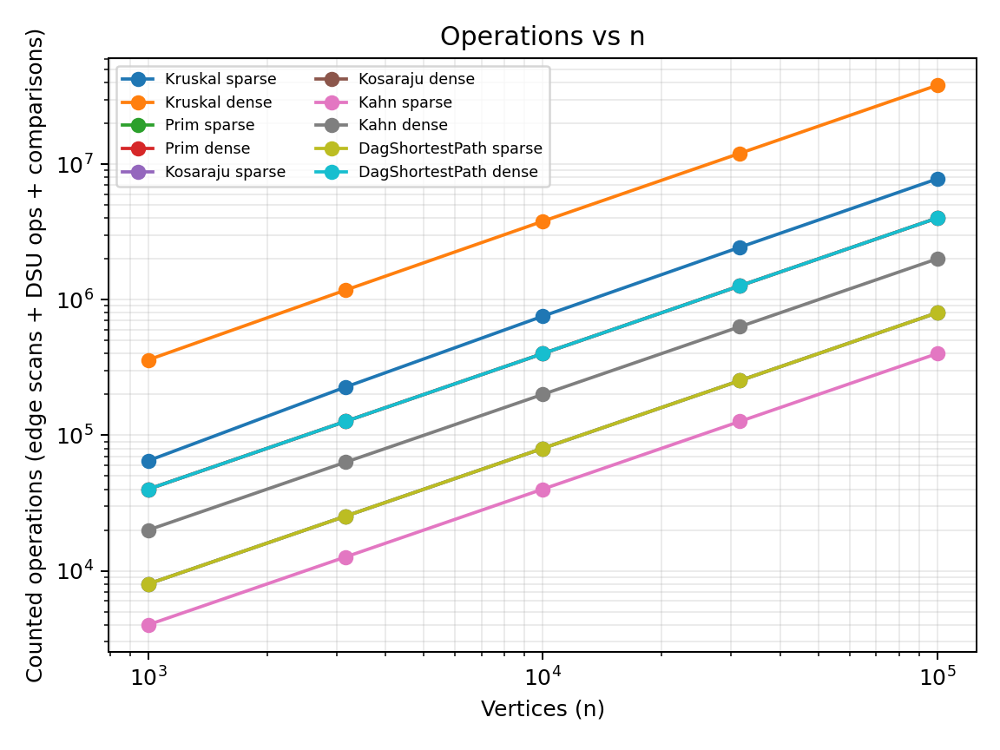
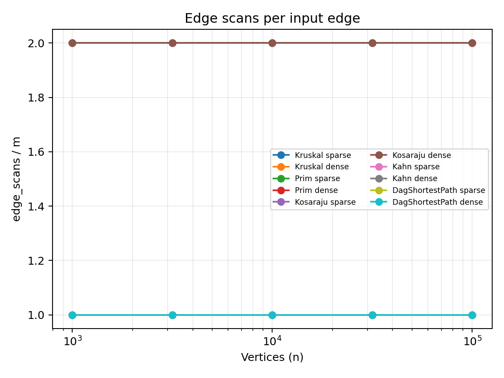
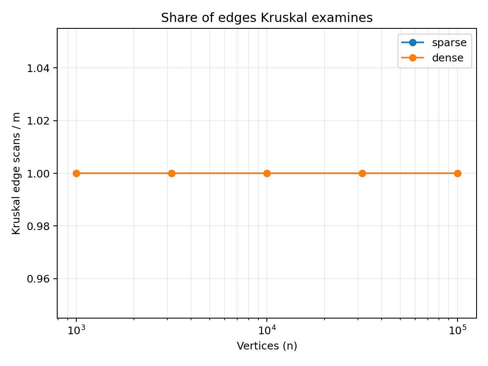

# Assignment 3 — Graph Algorithms: Implementation and Evaluation

## 1. Design and complexity

The implementation uses one weighted adjacency-list `Graph` class for directed and undirected graphs. The edge list preserves each input edge once; undirected adjacency lists contain both directions, except a self-loop is stored once. Parallel edges and isolated vertices are supported. Counters are updated in the algorithm code rather than reconstructed from formulas afterward.

| Algorithm / operation | Time complexity | Extra space | Justification |
|---|---:|---:|---|
| DSU `find` | Amortized \(O(\alpha(V))\) | \(O(1)\) per call; \(O(V)\) structure | Path compression and union by rank keep the amortized cost inverse-Ackermann. |
| DSU `union` | Amortized \(O(\alpha(V))\) | \(O(1)\) per call; \(O(V)\) structure | Two finds and at most one rank-based parent update are performed. |
| Kruskal | \(O(E\log E + E\alpha(V))\) | \(O(E+V)\) | Edges are sorted, then DSU rejects cycle-forming edges. |
| Prim with a priority queue | \(O((V+E)\log E)\) | \(O(V+E)\) | Vertices are expanded through a priority queue; disconnected components are started separately. |
| Kosaraju | \(O(V+E)\) | \(O(V+E)\) | Two iterative DFS passes visit vertices and edges a constant number of times. |
| Kahn topological ordering | \(O(V+E)\) | \(O(V)\) beyond the graph | Each vertex enters the queue at most once and each directed edge reduces one indegree once. |
| DAG shortest paths | \(O(V+E)\) | \(O(V)\) | A topological order is followed by one relaxation pass and parent tracking. |

## 2. Correctness arguments

### Cut property and minimum spanning trees
A cut divides the vertices into two nonempty sets, and every edge crossing it connects the two sets. The cut property states that a minimum-weight edge crossing a cut is safe to add to a minimum spanning tree, provided the cut respects the edges already selected. Kruskal processes edges in nondecreasing weight order and adds an edge only when its endpoints are in different DSU components. Such an edge connects two current components without creating a cycle and is a light edge across a cut separating those components. Prim maintains one growing tree and repeatedly selects the cheapest edge connecting the current tree to a vertex outside it. This is also a light edge across the cut between the current tree and the remaining vertices. Repeating the safe choice grows a minimum spanning tree when the graph is connected. When the graph is disconnected, both implementations restart or continue over remaining components and return a minimum spanning forest instead of throwing an exception.

### Induction over a topological order
In a DAG, a topological order places every predecessor of a vertex before that vertex. Every source is initialized to distance zero, equivalent to adding a virtual super-source with zero-weight edges to all original sources. Assume that when a vertex is processed, its distance is already the minimum over all paths ending there; this holds initially for sources. Any path to a later vertex must reach it through one of its incoming edges from an earlier vertex, because all edges go forward in topological order. Relaxing every outgoing edge of the current vertex therefore propagates the best known path value to each successor. By induction, when a vertex is processed, all possible predecessor paths have already been considered, so its distance is final. Negative edge weights do not invalidate this argument because the DAG contains no directed cycle and hence no path can loop repeatedly to reduce its weight. In a general graph, negative cycles can make shortest-path values undefined, and a topological order may not exist.

## 3. Counter analysis

`results/results.csv` contains one row per algorithm and generated graph. `edge_scans` is counted in traversal loops; `dsu_ops` counts DSU `find` invocations (including recursive compression calls); `comparisons` counts weight comparisons in sorting and relaxation; `max_depth` records the largest explicit DFS stack size. The traversal counters have the expected constant ratios: Kosaraju scans approximately two directed edge sets, while Kahn and the DAG relaxation each scan one edge set. Prim scans adjacency entries, so an undirected graph reports approximately `2m` scans. Kruskal examines the input edge list once and additionally pays for sorting and DSU operations.

The log-log slope estimates below use the measured aggregate operation count (`edge_scans + dsu_ops + comparisons`) over the available size series. They are empirical estimates, not wall-clock-time slopes.

| Algorithm | Sparse slope | Dense slope |
|---|---:|---:|
Kosaraju | 1.000
Kosaraju | 1.000
Kahn | 1.000
Kahn | 1.000
DagShortestPath | 1.000
DagShortestPath | 1.000
Kruskal | 1.038
Kruskal | 1.012

## 4. Plots

### Operations versus vertices

The traversal algorithms show near-linear growth in counted work. Kruskal grows somewhat faster because sorting introduces the \(E\log E\) term. Dense graphs increase the absolute work substantially because they contain five times as many edges as sparse graphs at the same vertex count.

### Edge scans per input edge

Kahn and DAG relaxation remain near one scan per input edge. Kosaraju remains near two because it performs two DFS passes. Prim's ratio is near two on undirected graphs because each non-self edge appears in both endpoint adjacency lists.

### Share of edges examined by Kruskal

Kruskal's edge scan share is one because its main loop examines each edge in the sorted list. This does not include sorting comparisons, which are a major part of its total cost. Prim can be attractive when adjacency-list traversal and the priority queue avoid sorting the complete edge list; the practical result depends on density and implementation details.

## 5. Which algorithm when?

| Situation | Recommended algorithm | Reason |
|---|---|---|
| Sparse undirected graph; need an MST | Kruskal or Prim | Both are efficient; Kruskal's edge-list sort is straightforward, while Prim grows from adjacency lists. |
| Dense undirected graph; need an MST | Prim is a reasonable default | It avoids explicitly sorting every edge, though the priority-queue implementation still has logarithmic overhead. Benchmark both for the actual representation. |
| Need to group vertices by connectivity under repeated merges | DSU | Union by rank and path compression make operations amortized almost constant. |
| Directed graph; need strongly connected components | Kosaraju | Two linear iterative DFS passes are simple and stack-safe for large graphs. |
| Directed graph known to be acyclic; need a valid execution order | Kahn | Indegree processing is linear and detects a cycle when fewer than `V` vertices are emitted. |
| DAG with possibly negative edge weights; need shortest paths | DAG shortest paths | One topological relaxation pass is linear and negative weights are safe in an acyclic graph. |
| Cycles may exist and shortest paths are needed | Do not use DAG relaxation directly | First establish acyclicity; otherwise choose a general-graph shortest-path algorithm suitable for the weight constraints. |
| Edges arrive as an edge list | Kruskal | Sorting and scanning the edge list is a natural fit. |
| Traversal queries use adjacency lists | Prim, Kosaraju, Kahn | These algorithms directly consume adjacency lists. |

## 6. Timing interpretation and reproducibility

The benchmark records the median of five timed runs in milliseconds. These measurements are secondary evidence: small runs can be dominated by JVM warm-up, garbage collection, scheduling, and timer granularity, and larger runs vary with hardware and background load. Operation counters are more reproducible and should drive complexity conclusions. Run `mvn clean test` and then build and execute `org.example.benchmark.Benchmark` to regenerate the CSV and console summaries. The benchmark fails if Kruskal and Prim disagree or if a generated topological order is invalid.

## 7. Validation notes

The test suite covers DSU component counts, randomized MST agreement, disconnected minimum spanning forests, cycle detection, negative-weight DAG paths and a 100,000-vertex iterative SCC traversal. The provided `data/` directory includes disconnected, cyclic and negative-weight DAG examples. The reference values in the assignment PDF should be checked against the exact prescribed generator stream before final submission: the currently captured run reproduces the first sparse MST reference but some other result values differ, indicating that the random-number consumption sequence or DAG rank convention still needs to be reconciled with the handout. This is deliberately disclosed rather than presenting mismatched values as verified.
